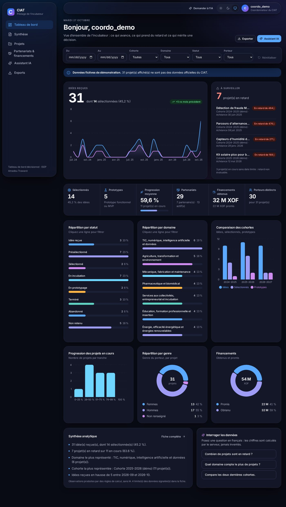

# Tableau de bord décisionnel du CIAT

Application web de pilotage de l'incubateur du CIAT (ISEP Amadou Trawaré) — **Projet 3** de l'évaluation pratique en IA générative. Elle permet de **consulter, filtrer, analyser et exporter** les données sur les idées, projets, retards, partenariats et financements, et d'interroger ces données en langage naturel.



> ⚠️ **Données fictives.** Les données de démonstration sont synthétiques, étiquetées et signalées dans l'interface. Aucune donnée officielle du CIAT n'est incluse. L'application n'est **pas déployée** et **n'est pas déclarée prête pour la production** : voir « Limites ».

## Fonctionnalités implémentées
- Authentification sécurisée (accès en mémoire + refresh HttpOnly rotatif), 4 rôles appliqués côté serveur, gestion des utilisateurs, verrouillage anti-force-brute, journal d'audit.
- Gestion des projets, porteurs, cohortes, partenariats, financements (formulaires validés côté client **et** serveur, données persistées dans PostgreSQL).
- Filtres combinables (période, cohorte, domaine, statut, porteur) appliqués à l'API, aux indicateurs et aux graphiques ; état partageable dans l'URL.
- Indicateurs aux règles documentées, graphiques interactifs, comparaison de cohortes, fiche de synthèse avec **limites des données**.
- Exports **PDF, Excel, image** (filtres et droits respectés).
- **Assistant IA** : calculs faits par le serveur, explication par un modèle **si** une clé est configurée, garde-fou anti-chiffres inventés ; sinon message explicite « service non configuré ».
- Interface inspirée visionOS / Liquid Glass : tokens, verre maîtrisé, clair/sombre, responsive, accessibilité de base, `prefers-reduced-motion`.

## Démarrage rapide
Voir **`docs/installation.md`** (Docker Compose ou installation sans Docker, commandes PowerShell).
```powershell
Copy-Item .env.example .env        # puis renseigner POSTGRES_PASSWORD et DJANGO_SECRET_KEY
docker compose build ; docker compose up -d
docker compose run --rm -e ALLOW_DEMO_SEED=true -e DJANGO_DEBUG=true backend python manage.py seed_demo --with-users
```
→ http://localhost:8080

## Structure
```
backend/      Django + DRF (apps : accounts, projects, partnerships, analytics, ai_assistant, audit, core) + tests
frontend/     React + TypeScript + Vite + Tailwind (src/{app,components,features,layouts,lib,pages,schemas,services,types,tests})
database/     schéma et dictionnaire des données
docs/         documentation (voir ci-dessous)
infrastructure/, scripts/, .github/workflows/, docker-compose.yml, Makefile, .env.example
```

## Documentation
| Document | Contenu |
|---|---|
| `docs/cahier_des_charges.md`, `docs/matrice_conformite.md` | Besoin, exigences, hypothèses ; conformité au sujet |
| `docs/architecture.md` | Architecture, auth, rôles, **règles des indicateurs**, assistant IA |
| `docs/api.md` | Endpoints, erreurs, filtres |
| `docs/installation.md`, `docs/deploiement.md` | Installation locale ; préparation du déploiement, sauvegardes, retour arrière |
| `docs/securite.md` | Mesures, vérifications, **limites** |
| `database/` | Schéma, dictionnaire |
| `docs/data_integration.md` | Import du jeu de données du data analyst, correspondances, écarts de définition |
| `docs/guide_utilisateur.md` | Guide initial |
| `docs/tests.md` | Résultats réels et éléments non exécutés |
| `docs/integration_equipe.md` | Où brancher le travail du data analyst et de l'infographe |
| `docs/git_workflow.md` | Git/GitHub (PowerShell), branches, PR, conflits |
| `docs/journal_prompts.md`, `docs/fiche_anomalie.md`, `docs/rapport_elements.md`, `VERSIONS.md` | Journal IA, modèle d'anomalie, aide au rapport, versions |

## Limites principales
Docker, appel réel à l'IA, restauration de sauvegarde, déploiement et accessibilité outillée **non testés** ; compteurs de limitation en mémoire locale (à remplacer par un cache partagé en production) ; charte ISEP, maquettes, données réelles, rapport, vidéo et lien de déploiement **à produire par l'équipe**. Détails : `docs/securite.md`, `docs/tests.md`, `docs/matrice_conformite.md`.
