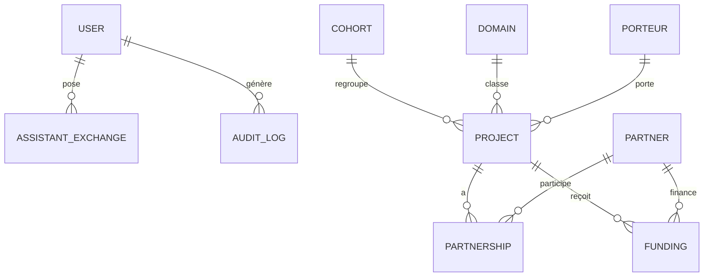

# Schéma de la base

## Contraintes d'intégrité (en base, pas seulement dans l'application)
| Table | Contrainte |
|---|---|
| `projects_project` | `CHECK progress BETWEEN 0 AND 100` ; `CHECK deadline >= start_date` (si les deux) ; FK `PROTECT` vers cohorte, domaine, porteur (on ne supprime pas une cohorte/un porteur utilisé) |
| `projects_cohort` | `CHECK end_date >= start_date` ; `name` unique |
| `projects_domain` | `code` et `label` uniques |
| `partnerships_partnership` | `UNIQUE(project, partner, nature)` ; FK `CASCADE` vers projet, `PROTECT` vers partenaire |
| `partnerships_funding` | `CHECK amount_xof > 0` ; FK `CASCADE` vers projet |
| `partnerships_partner` | `name` unique |
| `accounts_user` | `username` unique ; `email` unique (NULL accepté) |

Règles métier supplémentaires validées par l'API (voir `ProjectSerializer.validate`) : démarrage ≥ réception ; projet *Terminé* ⇒ progression 100 ; *Reçu/Non retenu* ⇒ progression 0 et pas de prototype ; montant ≤ 10 milliards XOF.

## Index
`projects_project` : `status`, `received_date`, `deadline`, `(cohort, domain)` ; `partnerships_funding` : `(project, status)` ; `partnerships_partnership` : `project` ; `audit_auditlog` : `action`, `created_at`.
