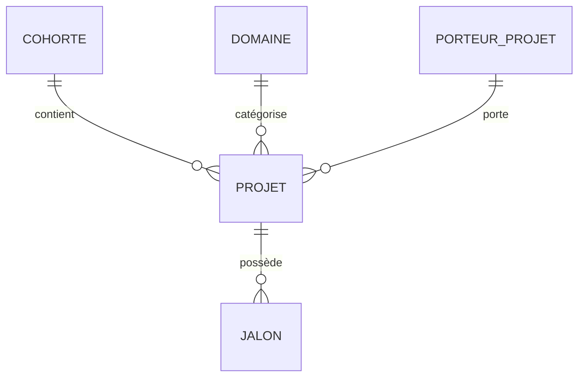

# Dictionnaire des Données — CIAT
## Centre d'Innovation, d'Application et de Transfert
### ISEP Amadou Trawaré de Diamniadio

**Version** : 1.0  
**Date** : 26 octobre 2026  
**Auteur** : Data Analyst — Équipe Projet 3  
**Fichier source** : `data/donnees_ciat.json`

---

## 1. Vue d'ensemble du modèle de données

Le jeu de données du CIAT est structuré en **7 collections principales**. Les relations par identifiant présentes dans le JSON sont celles entre les cohortes, domaines, porteurs, projets et jalons :

Les indicateurs de candidatures et de sélections sont des agrégats par cohorte : 77 sélections sont comptabilisées, tandis que la collection `projets` contient 20 projets détaillés, soit un sous-ensemble. Les analyses par projet portent sur ces 20 enregistrements. Les candidatures ne sont pas ventilées par domaine ou statut.

Les collections `financements`, `partenariats` et `evenements` ne portent pas de clé étrangère vers les projets ou les cohortes. Les noms de partenaires mentionnés dans les projets sont des libellés, pas des identifiants de relation.

---

## 2. Table : COHORTES

Regroupe les promotions annuelles de projets incubés.

| Champ | Type | Description | Exemple | Contraintes |
|-------|------|-------------|---------|-------------|
| `id` | String | Identifiant unique de la cohorte | `COH-2023` | PK, Format: COH-AAAA |
| `nom` | String | Nom affiché | `Cohorte 2023` | Non nul |
| `annee` | Integer | Année de la cohorte | `2023` | 2023–2026 |
| `date_debut` | Date (ISO 8601) | Date de lancement | `2023-03-15` | Non nul |
| `date_fin` | Date (ISO 8601) | Date de clôture | `2023-12-20` | ≥ date_debut |
| `nb_candidatures` | Integer | Nombre de dossiers reçus | `45` | ≥ 0 |
| `nb_selectionnes` | Integer | Nombre de projets retenus | `12` | ≤ nb_candidatures |
| `statut` | String | État de la cohorte | `Terminée` | {Terminée, En cours} |

**Règles de qualité** :
- `nb_selectionnes` ≤ `nb_candidatures`
- `date_fin` ≥ `date_debut`
- 4 enregistrements (2023–2026)

---

## 3. Table : DOMAINES

Nomenclature de premier niveau demandée pour le projet : **TIC** et **Automobile**. Chaque domaine contient une liste de sous-domaines. Les projets associés aux sous-domaines TIC ci-dessous sont des exemples simulés; aucun des projets reçus ne décrit clairement une activité automobile.

| Champ | Type | Description | Exemple | Contraintes |
|-------|------|-------------|---------|-------------|
| `id` | String | Identifiant unique du domaine | `DOM-TIC` | PK |
| `nom` | String | Nom du domaine principal | `TIC` | {TIC, Automobile} |
| `code` | String | Code court | `TIC` | Non nul, unique |
| `couleur` | String | Code hexadécimal pour les graphiques | `#6366F1` | Format hex valide, unique |
| `sous_domaines` | Array[SOUS_DOMAINE] | Sous-domaines du domaine | Voir nomenclature ci-dessous | Au moins un sous-domaine |

### Sous-domaines validés

| Domaine | ID | Sous-domaine |
|---------|----|--------------|
| TIC | `TIC-SD-01` | Analyse des performances digitales |
| TIC | `TIC-SD-02` | Administration de bases de données |
| TIC | `TIC-SD-03` | Administration systèmes, sécurité et cloud |
| TIC | `TIC-SD-04` | Réseaux, sécurité et IoT |
| TIC | `TIC-SD-05` | Développement backend |
| TIC | `TIC-SD-06` | Développement frontend |
| Automobile | `AUTO-SD-01` | Électromécanique automobile |
| Automobile | `AUTO-SD-02` | Carrosserie et peinture |
| Automobile | `AUTO-SD-03` | Froid et climatisation automobile |
| Automobile | `AUTO-SD-04` | Électromécanique et électronique automobile |

Les libellés ont été corrigés en français sans changer le sens communiqué. Les identifiants de sous-domaines sont stables pour les filtres, les graphiques et les échanges avec l'application.

---

## 4. Table : PORTEURS_PROJETS

Informations sur les porteurs de projets (données fictives à des fins académiques).

| Champ | Type | Description | Exemple | Contraintes |
|-------|------|-------------|---------|-------------|
| `id` | String | Identifiant unique | `PP-001` | PK, Format: PP-XXX |
| `nom` | String | Nom de famille | `Diallo` | Non nul |
| `prenom` | String | Prénom | `Mamadou` | Non nul |
| `genre` | String | Genre | `M` | {M, F} |
| `age` | Integer | Âge au moment de la candidature | `24` | 18–35 |
| `formation` | String | Filière de formation | `Génie Informatique` | Non nul |
| `email` | String | Adresse email institutionnelle | `m.diallo@isep.sn` | Format email valide |
| `telephone` | String | Numéro de téléphone | `+221770001001` | Format international |

**Règles de qualité** :
- 25 porteurs enregistrés
- Données personnelles **fictives** — en production, pseudonymisation obligatoire (RGPD/Loi 2008-12)
- Répartition du registre : 13 hommes (52%) et 12 femmes (48%)

---

## 5. Table : PROJETS

Entité centrale contenant les informations détaillées de chaque projet incubé.

| Champ | Type | Description | Exemple | Contraintes |
|-------|------|-------------|---------|-------------|
| `id` | String | Identifiant unique | `PRJ-001` | PK, Format: PRJ-XXX |
| `titre` | String | Nom du projet | `AgriSmart SN` | Non nul, unique |
| `description` | String | Description courte | `Application mobile...` | Non nul |
| `domaine_id` | String/Null | FK vers DOMAINES | `DOM-TIC` | FK cohérente avec le sous-domaine; null si non classé |
| `sous_domaine_id` | String/Null | FK vers un sous-domaine du domaine indiqué | `TIC-SD-05` | Sous-domaine appartenant à `domaine_id`, ou null si classement non validé |
| `cohorte_id` | String | FK vers COHORTES | `COH-2023` | FK, Non nul |
| `porteur_id` | String | FK vers PORTEURS_PROJETS | `PP-004` | FK, Non nul |
| `mentor` | String | Nom du mentor assigné | `Dr. Samba Ndour` | Non nul |
| `statut` | String | Statut actuel | `Prototype validé` | {Idée, En cours, Prototype validé, Déployé, Abandonné} |
| `phase` | String | Phase du parcours | `Post-incubation` | {Pré-incubation, Incubation, Post-incubation} |
| `date_soumission` | Date | Date de dépôt du dossier | `2023-03-20` | Non nul |
| `date_selection` | Date | Date de sélection | `2023-04-15` | ≥ date_soumission |
| `budget_demande` | Integer | Budget demandé (FCFA) | `3500000` | > 0 |
| `budget_accorde` | Integer | Budget accordé (FCFA) | `2800000` | ≤ budget_demande |
| `budget_depense` | Integer | Budget dépensé (FCFA) | `2650000` | ≤ budget_accorde |
| `nb_membres_equipe` | Integer | Taille de l'équipe | `3` | 1–10 |
| `progression` | Integer | Pourcentage d'avancement | `95` | 0–100 |
| `note_evaluation` | Float/Null | Note du comité (/20) | `16.5` | 0–20 ou null (non évalué) |
| `retard_jours` | Integer | Jours de retard cumulé | `0` | ≥ 0 |
| `partenaires` | Array[String] | Liste des partenaires associés | `["ISRA", "FAO"]` | Peut être vide |
| `objectifs_atteints` | Integer | Nb d'objectifs réalisés | `8` | ≤ objectifs_total |
| `objectifs_total` | Integer | Nb total d'objectifs | `9` | > 0 |
| `jalons` | Array[JALON] | Étapes clés du projet | Voir table JALONS | ≥ 1 jalon |

Les éléments de `partenaires` sont des noms en texte libre; ils ne sont pas reliés par clé étrangère à la collection `partenariats`.

**Règles de qualité** :
- 20 projets détaillés répartis sur 4 cohortes; ils ne représentent pas l'ensemble des 77 sélections agrégées
- Si le domaine est renseigné, le sous-domaine doit appartenir au domaine parent
- Si le domaine n'est pas validé, `domaine_id` et `sous_domaine_id` restent tous deux à null
- `budget_accorde` ≤ `budget_demande`
- `budget_depense` ≤ `budget_accorde`
- `objectifs_atteints` ≤ `objectifs_total`
- `progression` à 15 points au plus du ratio `objectifs_atteints/objectifs_total`

---

## 6. Sous-table : JALONS (imbriquée dans PROJETS)

Étapes clés avec dates prévisionnelles et réelles.

| Champ | Type | Description | Exemple | Contraintes |
|-------|------|-------------|---------|-------------|
| `nom` | String | Intitulé du jalon | `Étude de marché` | Non nul |
| `date_prevue` | Date | Date prévisionnelle | `2023-05-01` | Non nul |
| `date_reelle` | Date/Null | Date effective de réalisation | `2023-04-28` | Null si non réalisé |
| `statut` | String | État du jalon | `Terminé` | {Terminé, En cours, En retard, Planifié, Abandonné} |

**Règles de qualité** :
- 3 à 4 jalons par projet
- Si `statut` = "Terminé", `date_reelle` ne doit pas être null
- Si `date_reelle` > `date_prevue`, le jalon est considéré en retard

---

## 7. Table : FINANCEMENTS

Synthèse budgétaire annuelle avec ventilation par source.

| Champ | Type | Description | Exemple | Contraintes |
|-------|------|-------------|---------|-------------|
| `annee` | Integer | Année fiscale | `2024` | 2023–2026 |
| `budget_total_alloue` | Integer | Enveloppe totale (FCFA) | `28400000` | > 0 |
| `budget_total_depense` | Integer | Total dépensé (FCFA) | `22700000` | ≤ budget_total_alloue |
| `sources` | Object | Ventilation par source | `{"ISEP": 12000000, ...}` | Somme = budget_total_alloue |

**Sources identifiées** : ISEP, Partenaires, Gouvernement, International

---

## 8. Table : PARTENARIATS

Registre des partenaires du CIAT.

| Champ | Type | Description | Exemple | Contraintes |
|-------|------|-------------|---------|-------------|
| `partenaire` | String | Nom de l'organisation | `UNESCO` | Non nul |
| `type` | String | Catégorie | `International` | {Institutionnel, International, Gouvernemental, Entreprise, Professionnel, Recherche} |
| `specialite` | String | Secteur ou spécialité du partenaire (distinct de la classification TIC/Automobile des projets) | `Éducation` | Non nul |
| `date_debut` | Date | Début du partenariat | `2023-03-01` | Non nul |
| `actif` | Boolean | Partenariat en cours | `true` | {true, false} |

---

## 9. Table : EVENEMENTS

Événements organisés par le CIAT.

| Champ | Type | Description | Exemple | Contraintes |
|-------|------|-------------|---------|-------------|
| `id` | String | Identifiant unique | `EVT-001` | PK, Format: EVT-XXX |
| `titre` | String | Nom de l'événement | `Demo Day Cohorte 2023` | Non nul |
| `date` | Date | Date de l'événement | `2023-12-18` | Non nul |
| `type` | String | Type d'événement | `Demo Day` | {Portes ouvertes, Demo Day, Hackathon, Forum, Semaine thématique, Atelier, Conférence, Cérémonie} |
| `participants` | Integer | Nombre de participants | `85` | > 0 |

---

## 10. Contrôles de qualité appliqués

| # | Contrôle | Résultat | Méthode |
|---|----------|----------|---------|
| CQ-01 | Présence des collections et complétude des champs obligatoires | ✅ Réussi | `node data\validate_data.js` |
| CQ-02 | Cohérence des clés étrangères des projets | ✅ Toutes les références résolues | Script de validation |
| CQ-03 | Cohérence budgétaire par projet | ✅ Dépensé ≤ accordé ≤ demandé | Script de validation |
| CQ-04 | Validité et ordre des dates, cohérence des jalons terminés | ✅ Réussi | Script de validation |
| CQ-05 | Plages des notes, progressions, objectifs et retards | ✅ Réussi | Script de validation |
| CQ-06 | Unicité des identifiants définis, titres de projets, partenaires et années financières | ✅ Aucun doublon | Script de validation |
| CQ-07 | Format des emails et téléphones des porteurs | ✅ Réussi | Expressions régulières |
| CQ-08 | Domaines et sous-domaines conformes à la liste validée | ✅ 2 domaines, 10 sous-domaines | Script de validation |
| CQ-09 | Statuts autorisés et couleurs distinctes/formatées | ✅ Réussi | Script de validation |
| CQ-10 | Ventilation annuelle des financements | ✅ Somme des sources = budget alloué | Script de validation |
| CQ-11 | Périmètre des analyses par projet | ⚠️ 20 projets détaillés pour 77 sélections agrégées | Écart explicitement documenté |

Le contrôle CQ-11 est une limite de périmètre, pas une erreur de clé : les deux collections décrivent des niveaux d'agrégation différents. Aucun projet automobile n'est clairement présent parmi les exemples reçus; deux projets de robotique restent sans affectation afin de ne pas leur attribuer un sous-domaine inexact. En 2024, l'enveloppe annuelle excède de 3,8 M FCFA les budgets accordés aux projets détaillés de cette cohorte; le fichier ne permet pas d'expliquer cet écart.

---

## 11. Protection des données

> ⚠️ **AVERTISSEMENT** : Les données personnelles (noms, prénoms, emails, téléphones) contenues dans ce jeu de données sont **entièrement fictives** et créées à des fins pédagogiques. Toute ressemblance avec des personnes réelles serait fortuite.

En production, les mesures suivantes seraient indispensables :
- **Pseudonymisation** des données personnelles conformément à la Loi sénégalaise n°2008-12 sur la protection des données à caractère personnel
- **Contrôle d'accès par rôle** (RBAC) sur les données sensibles
- **Journalisation des accès** aux données
- **Chiffrement au repos et en transit**
- **Droit d'accès, de rectification et de suppression** pour les porteurs de projets

---

## 12. Interface de l’assistant de données

La navigation **Assistant IA** (`section-assistant`) fournit uniquement une maquette d’interface. Le champ de saisie, le bouton d’envoi et les exemples de questions sont désactivés tant que le backend n’est pas connecté; aucune réponse n’est simulée.

Pour le raccordement, la développeuse devra :
- relier le formulaire et la zone de conversation (`assistantQuestion`, `assistantMessages`) à un endpoint backend sécurisé;
- transmettre la question et, si nécessaire, les filtres actifs du tableau de bord;
- afficher les réponses, les sources/périmètres utilisés et les erreurs de service de façon explicite;
- garder les clés et secrets côté serveur, jamais dans les fichiers du navigateur;
- préciser que `projets` contient 20 projets détaillés, distincts des 77 sélections agrégées par cohorte, et ne pas produire de ventilation par domaine à partir d’agrégats non ventilés.

---

*Document généré dans le cadre de l'évaluation pratique du cours d'Intelligence Artificielle Générative — ISEP Amadou Trawaré de Diamniadio, 2026.*
